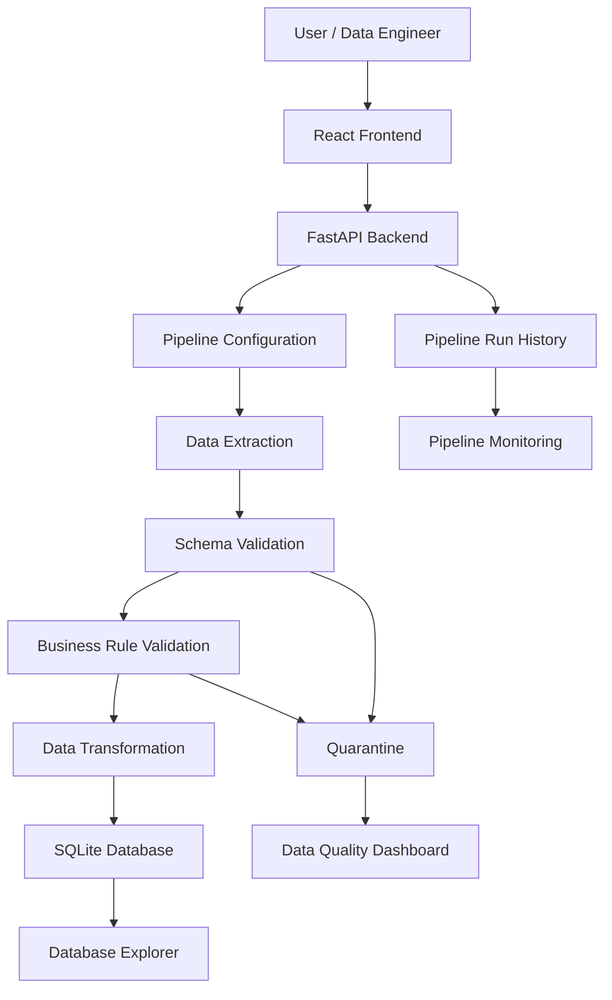

# YottaFlex Data Platform

A configuration-driven data engineering platform that simplifies data ingestion, validation, transformation, and loading through a unified interface.

## Project Overview

YottaFlex Data Platform is designed to eliminate hard-coded data ingestion workflows. It allows data engineers to configure pipelines using metadata, process CSV and JSON datasets, validate data quality, and load clean records into an SQLite database.

The platform provides a web-based interface to configure pipelines, execute data workflows, inspect database records, monitor pipeline history, and investigate rejected records.

## Key Features

- **Configuration-driven pipelines:** Define source paths, formats, schemas, primary keys, targets, and load strategies through configuration.
- **Multiple input formats:** Supports CSV and JSON ingestion.
- **Schema validation:** Validates required columns, data types, nullability, and primary keys.
- **Business rule validation:** Checks email formats, numeric ranges, and other configured rules.
- **Data transformation:** Supports whitespace cleaning, type conversion, renaming, and other configured transformations.
- **Multiple loading strategies:**
  - Append – Adds new records.
  - Replace – Replaces existing target data.
  - Upsert – Updates matching records and inserts new records.
- **Data quarantine:** Stores rejected records with validation errors for investigation.
- **Pipeline monitoring:** Tracks execution status, record counts, and processing history.
- **Database Explorer:** Browse SQLite tables, schemas, and stored records.
- **Interactive dashboard:** View pipeline and data quality metrics.

## Technology Stack

| Component | Technology |
|---|---|
| Frontend | React.js, Vite, JavaScript |
| Backend | Python, FastAPI |
| Database | SQLite |
| Data Processing | Python |
| API Communication | REST APIs |
| Testing | Pytest |
| Development Environment | Visual Studio Code |
| Version Control | Git and GitHub |

## Architecture



## Pipeline Workflow

1. Configure pipeline metadata.
2. Specify the source file and input format.
3. Define schema, data types, nullability, and primary keys.
4. Configure business validation rules.
5. Select the target database table.
6. Choose Append, Replace, or Upsert.
7. Validate the configuration.
8. Execute the pipeline.
9. Extract, validate, and transform records.
10. Load valid records into SQLite.
11. Send rejected records to quarantine.
12. Monitor execution results and data quality metrics.

## Project Structure

```text
CandidateWorkspace/
│
├── backend/
│   ├── app/
│   │   ├── api/
│   │   ├── services/
│   │   ├── validators/
│   │   └── main.py
│   ├── data/
│   │   ├── customers.csv
│   │   └── json_customers.json
│   ├── tests/
│   ├── requirements.txt
│   └── README.md
│
├── frontend/
│   ├── src/
│   ├── public/
│   ├── package.json
│   └── ...
│
└── .gitignore
```

*Note: The structure above highlights the main components. Refer to the actual folders in the repository for the complete implementation.*

## Installation and Setup

### Prerequisites

- Python 3.14
- Node.js and npm
- Git
- Visual Studio Code

### 1. Clone the repository

```bash
git clone https://github.com/rajeshrrln/yottaflex-data-platform-.git
cd yottaflex-data-platform-
```

### 2. Configure the backend

Open a terminal:

```powershell
cd backend

python -m venv .venv

.\.venv\Scripts\Activate.ps1

pip install -r requirements.txt
```

### 3. Start the backend server

```powershell
python -m uvicorn app.main:app --reload --port 8000
```

Backend URL:

http://127.0.0.1:8000

Interactive API documentation:

http://127.0.0.1:8000/docs

### 4. Configure the frontend

Open a second terminal:

```powershell
cd frontend

npm install

npm run dev
```

Frontend URL:

http://localhost:5176

## API Endpoints

| Method | Endpoint | Purpose |
|---|---|---|
| GET | `/health` | Backend health check |
| POST | `/api/pipelines/run` | Execute a pipeline |
| GET | `/api/pipelines/history` | Retrieve pipeline execution history |
| GET | `/api/datasets` | List available datasets |
| GET | `/api/datasets/{table_name}` | Inspect dataset records |
| GET | `/api/quarantine/` | Retrieve quarantined records |
| GET | `/api/quarantine/summary` | View quarantine statistics |

## Data Loading Strategies

### Append
Adds incoming records to the target table without intentionally replacing existing data.

### Replace
Clears existing target data and loads the latest validated records.

### Upsert
Updates records matching configured primary keys and inserts records that do not already exist.

## Data Quality Management

The platform validates records at different stages:

- Schema validation
- Required-field validation
- Data type validation
- Primary key validation
- Email format validation
- Numeric range validation

Invalid records are quarantined with their source information and validation issues.

## Testing

Run backend tests from the backend directory:

```powershell
cd backend

.\.venv\Scripts\Activate.ps1

python -m pytest -v
```

## Demonstrated Test Scenarios

The application has been manually tested with:

- CSV ingestion
- JSON ingestion
- Append loading
- Replace loading
- Upsert loading
- Invalid email rejection
- Quarantine persistence
- Pipeline history
- SQLite database exploration

Refer to the repository's automated test suite for detailed test coverage.

## Future Enhancements

- Support for PostgreSQL and MySQL.
- Cloud storage integration.
- Scheduled pipeline execution.
- Advanced data profiling.
- Pipeline retry and recovery mechanisms.
- Authentication and role-based access control.
- Real-time pipeline monitoring.

## Author

**Rajesh Kanchapogu**

GitHub: https://github.com/rajeshrrln

## License

This project is available for educational and demonstration purposes. A formal license can be added separately if the project is intended for broader reuse.